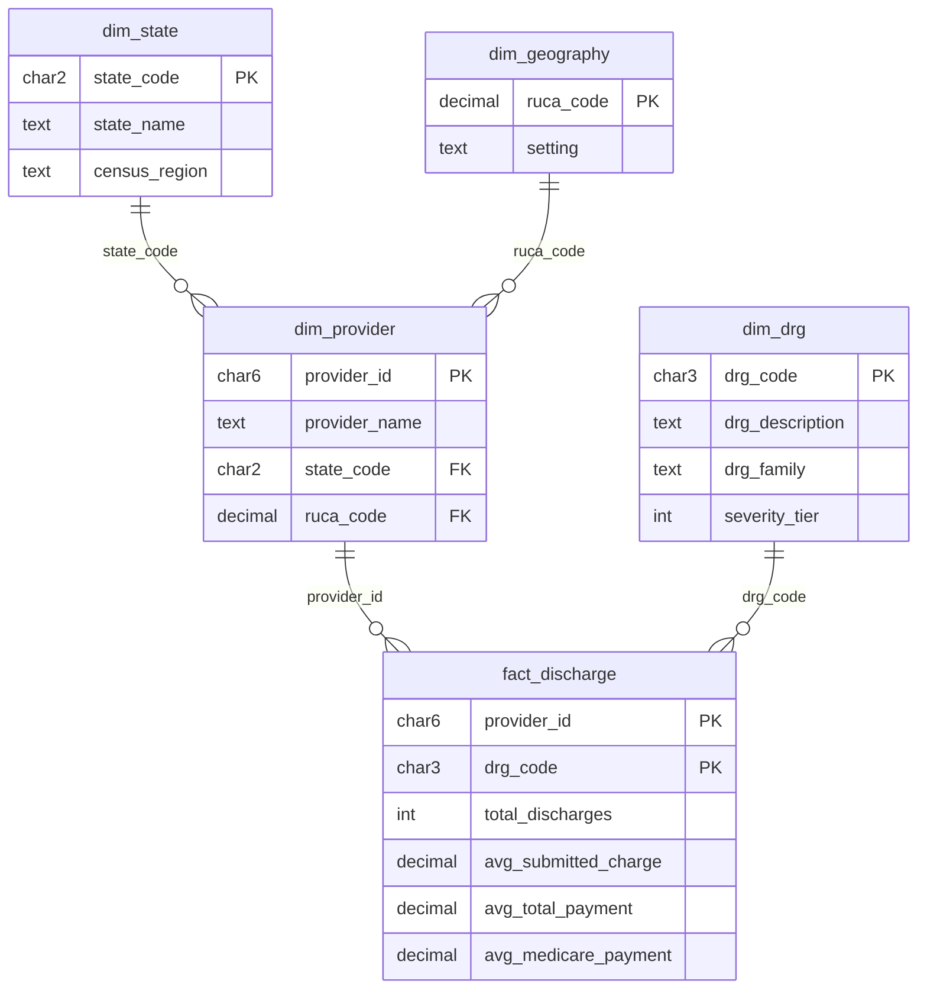
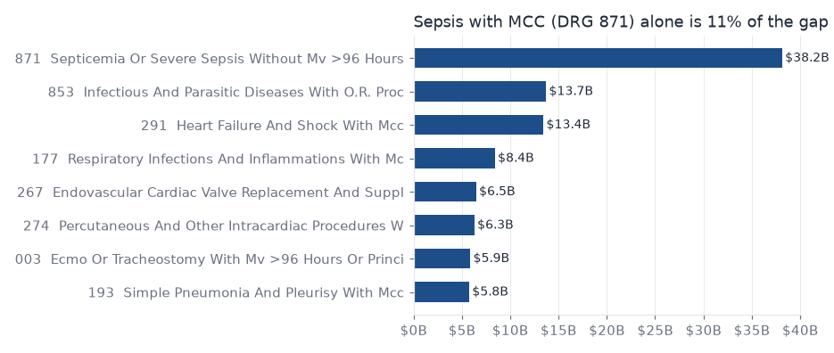
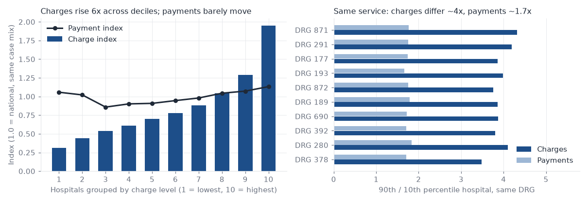
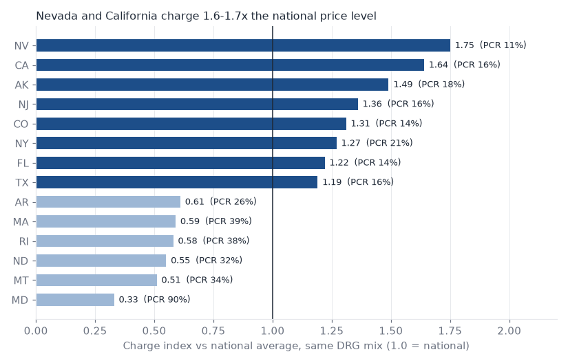
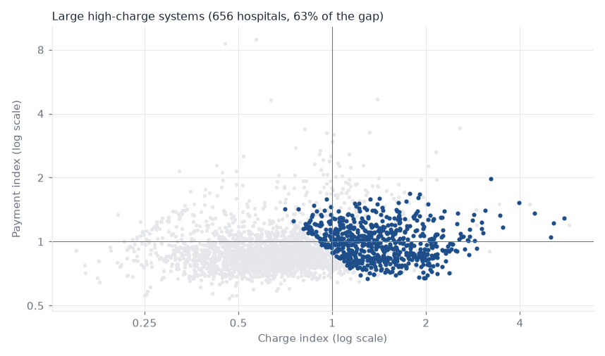
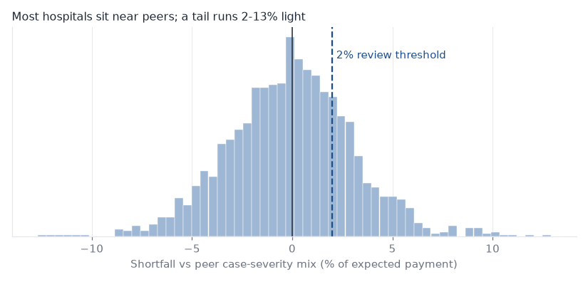

# Hospital Pricing, Payment & Documentation Opportunity
**Medicare inpatient analysis, 2,945 hospitals, 534 service lines, $432B in charges (CMS data year 2023)**

SQL · Python · Excel · Power BI &nbsp;|&nbsp; [Executive summary ↓](#3-executive-summary) &nbsp;|&nbsp; [Recommendations ↓](#5-recommendations) &nbsp;|&nbsp; [Data dictionary](docs/data_dictionary.md) &nbsp;|&nbsp; [Technical notes](docs/technical_notes.md)

---

## 1. Background & Overview

Hospital finance leaders see a stark number in Medicare data: hospitals list **$432B** of charges for inpatient stays and
are paid **$88B**. The question put to analytics was: *is the $344B difference revenue we are losing, and if not, where can we actually
improve results?*

This analysis benchmarks every Medicare inpatient hospital and service line, separates what hospitals **control** (what they list and how they
document care) from what they do **not** (Medicare's fixed per-DRG payment), and sizes the lever that is real.

**Goals:** (1) size and locate the charge-to-payment gap, (2) explain what drives it, (3) segment hospitals for targeted action,
(4) quantify the opportunity that is within a hospital's control.

## 2. Data Structure Overview

Source: CMS *Medicare Inpatient Hospitals by Provider and Service*, 2023 (146,427 hospital × DRG rows). Rebuilt as a star schema so
every metric is a join away and defined once in SQL.

| Table | Grain | Key fields |
|---|---|---|
| `fact_discharge` | hospital × DRG | discharges, charge, total payment, Medicare payment |
| `dim_provider` | hospital | name, city, state, rural-urban code |
| `dim_drg` | service line | title, severity tier (MCC / CC / none) |

Key terms: **charges** = a hospital's list price. **Payment** = what is actually paid, all payers. **Payment-to-charge ratio (PCR)** = payment ÷ charges.
**Charge index** = a hospital's charges vs the national average for the *same mix of DRGs* (1.00 = national).

## 3. Executive Summary

The headline gap is **$344B (80% of charges)**, but it is a **list-price effect, not lost revenue**: Medicare pays a fixed rate per DRG whatever a hospital
lists, and **about 97% of the variation in payment-to-charge ratios across hospitals comes from what hospitals charge, not from what they are paid**.
For the same service, hospitals' charges differ about 4× between the 90th and 10th percentile; payments differ about 1.7×.
The gap is concentrated: **240 hospitals (8%)** and **25 service lines (5%)** account for half of it, and **656 large high-charge systems** hold 63%.
The payment lever hospitals do control is **severity documentation**: 473 hospitals bill a case mix at least 2% lighter than peers,
worth **~$139M a year at a 25% capture rate** (range $56M–$277M), starting with **$31M from a 25-hospital pilot**.

## 4. Insights Deep Dive

### Insight 1: The gap is large, concentrated, and led by a few service lines
**Metric:** share of the $344B charge gap · **Evidence:** DRG 871 (sepsis with major complications) alone is **11.1% ($38B)**; the top 5 DRGs are 25% and the top 25 are 50%.
The five largest hospital gaps (Cedars-Sinai, NYU Langone, NewYork-Presbyterian, Stanford, AdventHealth Orlando) total 6.4%.
**So what:** a short list of service lines and large systems is where pricing and documentation reviews pay off first.

### Insight 2: Hospitals differ in what they *charge*, not in what they are *paid*
**Metric:** variation in payment-to-charge ratio · **Evidence:** across hospitals sorted into ten groups by charge level, the charge index rises **6.3×**
(0.31 to 1.95) while the payment index moves only 1.06 to 1.13. Payment-to-charge falls from 70% to 12%. Maryland, which regulates hospital prices, has a ratio of **90%**
versus 20% nationally.
**So what:** a low payment-to-charge ratio signals a high list price, not an under-collection. Chasing the gap with collections effort cannot work.

### Insight 3: Price levels are regional, and high-charge systems carry most of the gap
**Metric:** charge index vs national, same DRG mix · **Evidence:** Nevada (1.75) and California (1.64) price ~65–75% above national; Maryland sits at 0.33.
Metropolitan hospitals charge 1.02 vs 0.64–0.74 in small-town and rural hospitals. Segmentation (k-means, five groups) finds
**656 large high-charge systems** (median charge index 1.36, payment index 0.99) holding **63%** of the gap at a 15.6% payment-to-charge ratio,
versus 932 large mainstream systems (charge index 0.68, payment index 0.85) at 27.0%.
**So what:** similar-sized systems are paid within about 15% of each other but list prices at twice the level; pricing governance belongs on the executive agenda.

<table><tr>
<td></td>
<td></td>
</tr></table>

### Insight 4: Severity documentation is the lever hospitals control
**Metric:** share of cases coded at the highest severity tier vs peers · **Evidence:** of 1,996 hospitals with enough volume, **981 sit below their peer case mix**
(worth $744M valued at national DRG payments, 1.07% of tiered payments); **473 are at least 2% below** ($555M).
At a 25% capture rate, a 25-hospital pilot is worth **$31M**, 100 hospitals **$75M**, all eligible hospitals **$139M**.
**So what:** a modest, auditable program, not a windfall. The screen identifies where to look; clinicians and compliance decide what is supportable.

## 5. Recommendations

| # | Action | Evidence | Size |
|---|---|---|---|
| 1 | **Stop reporting the charge gap as "revenue leakage."** Track payment-to-charge ratio and charge index vs peers instead. | 97% of PCR variation is charge-setting | Reframes every downstream decision |
| 2 | **Launch a 25-hospital documentation (CDI) pilot** at the largest shortfalls vs peers; scale to 100 if realised capture is 25% or more. | Insight 4 | $13M–$63M pilot; $31M base |
| 3 | **Put pricing governance on the 656 high-charge systems**, beginning with the 25 service lines that make up half the gap (sepsis, heart failure, respiratory infection first). | Insights 1 and 3 | Does not change Medicare payment; reduces patient and commercial-payer exposure (not measurable in this data) |
| 4 | **Add two KPIs to the finance dashboard:** charge index vs national, and top-tier case share vs peers, reviewed quarterly. | Power BI model in [`powerbi/`](powerbi/) | Early warning on both levers |
| 5 | **Next phase:** add earlier data years (trend), hospital cost reports for margin, and Medicare Advantage / commercial payment data. | Caveats below | Turns a screen into a forecast |

## 6. Caveats & Assumptions

- **Charges are not revenue.** The $344B gap is descriptive; nothing in this analysis recovers it.
- **Medicare fee-for-service only.** Medicare Advantage (about half of beneficiaries) and commercial payers are not in the data, so commercial price exposure is untested.
- **One year (2023).** There is no trend, so "why is it changing" cannot be answered; this is a cross-section.
- **Suppression.** CMS omits hospital × DRG cells of 10 or fewer discharges. Small hospitals and rare DRGs are under-represented, and suppressed cells can bias severity mix slightly. Severity screening excludes 949 of 2,945 hospitals with under 300 tiered discharges or fewer than 10 tiered families.
- **No cost data.** Profit margin cannot be computed; "opportunity" is payment effect, not profit.
- **Severity screen is not a forecast.** Lighter mixes can be clinically legitimate (e.g. complex patients transferred out); the 10/25/50% capture rates are assumptions, not estimates. Any documentation change must be clinically supported and compliant.
- **Data quality.** 281 rows (0.19%) show payment above charges; they are kept and flagged. 33 DRG titles are truncated by CMS and are left out of severity tiering. Full log in the [data dictionary](docs/data_dictionary.md).
- **Power BI:** the report is specified (model, DAX, theme, page layout) in [`powerbi/`](powerbi/) but the `.pbix` is not committed and the DAX has not been executed in Power BI Desktop; follow the check figures in its README.

---

## Repository guide

| Path | Contents |
|---|---|
| [`sql/`](sql/) | `01_schema` (star schema) · `02_views` (KPI definitions) · `03_analysis_queries` (CTEs, window functions) · `04_severity_mix` |
| [`python/build_database.py`](python/build_database.py) | Raw CMS file → SQLite star schema (IDs kept as text) |
| [`notebooks/healthcare_analysis.ipynb`](notebooks/healthcare_analysis.ipynb) | Cleaning, EDA, driver analysis, segmentation, severity screen, exports |
| [`excel/healthcare_opportunity_model.xlsx`](excel/healthcare_opportunity_model.xlsx) | Live-formula scenario model with assumptions, sensitivity, and v1 reconciliation |
| [`powerbi/`](powerbi/) | Model, DAX measures, Power Query loader, theme, build guide, star-schema CSVs |
| [`docs/`](docs/) | Data dictionary, technical notes, chart images, archived v1 |

*This README replaces v1, which reported a $717.6B "recoverable" gap. That figure double-counted a pivot-table total and treated list prices as revenue; the audit is in [technical notes](docs/technical_notes.md#audit-of-v1-kept-in-docsarchive_v1).*
